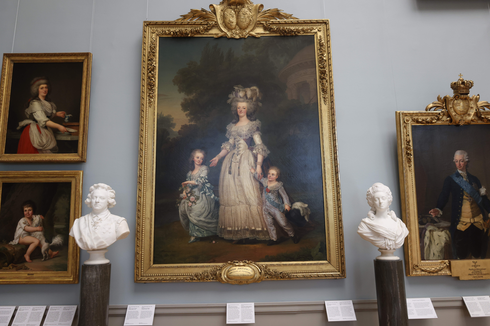
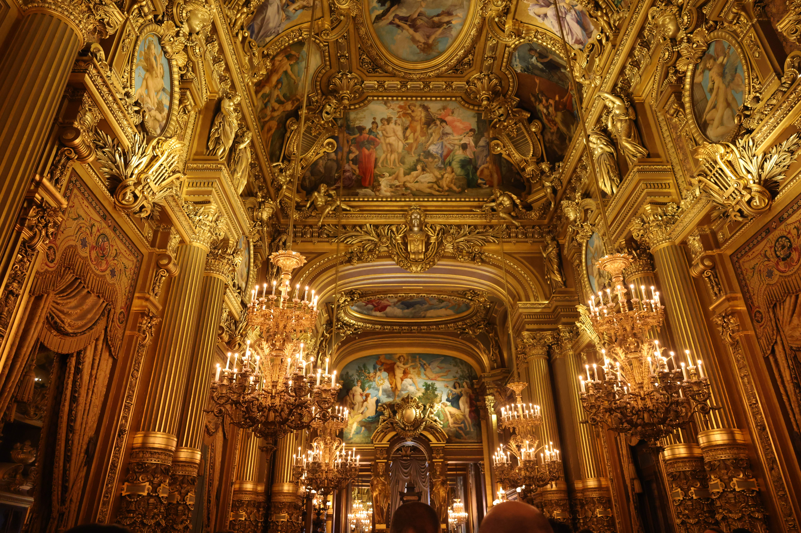
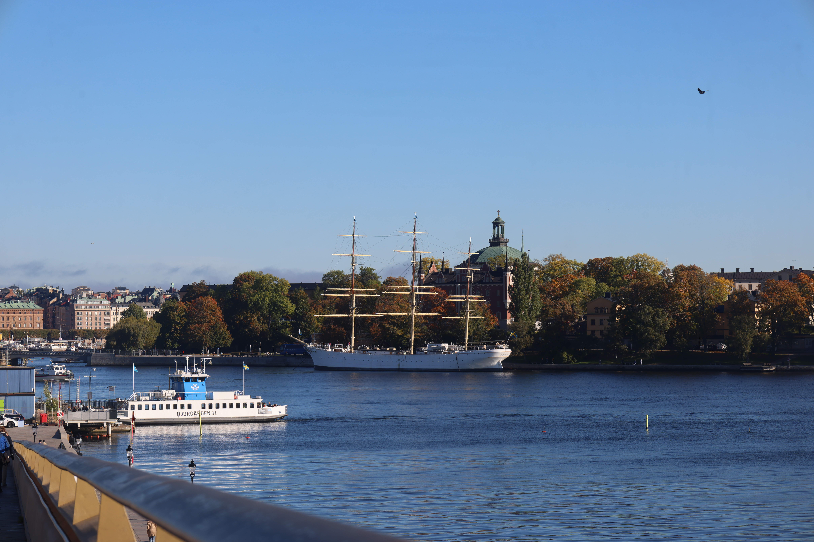
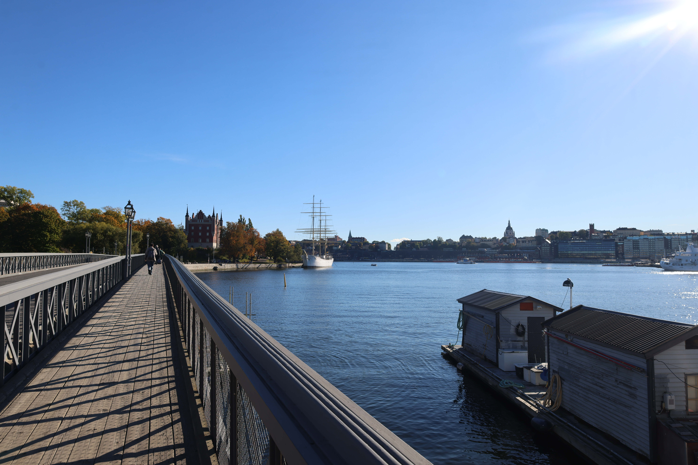

# Experimento Prático: Impacto da Compressão Lossy vs. Imagem Bruta em Visão Computacional e OCR

## 👨‍🏫 Informações Acadêmicas
- **Instituição:** Faculdade de Tecnologia de Ferraz de Vasconcelos (FATEC-FV)
- **Curso:** Análise e Desenvolvimento de Sistemas (ADS)
- **Disciplina:** Visão Computacional / Trabalho de Graduação (TG)
- **Professora Orientadora:** Profa. Márcia Bissaco
- **Pesquisador / Discente:** Josias Sobrinho
- **Contexto:** Estudo de Caso Prático Complementar ao artigo [dilema-edicao-imagens.md](dilema-edicao-imagens.md)

---

## 1. Descrição do Problema e Hipótese Experimental

Em recente atividade prática de laboratório, fomos desafiados a solucionar um problema clássico de visão computacional aplicada ao trânsito e segurança: **a leitura automatizada de placa veicular (ALPR/OCR) a partir de uma captura fotográfica severamente escurecida (subexposta)**.

### 🎯 O Desafio Técnico:
* A placa do veículo (um modelo Volkswagen Fusca) encontrava-se submersa em uma região de sombra profunda, com intensidades de pixel restritas ao intervalo quase nulo de $[0, 30]$ em uma escala de $[0, 255]$.
* Para que o motor OCR (Reconhecimento Óptico de Caracteres) conseguisse identificar os caracteres alfanuméricos, era estritamente mandatório executar um pipeline prévio de processamento digital de imagens:
  1. **Elevação e Realce de Sombras** (expansão da faixa dinâmica na região subexposta);
  2. **Segmentação e Localização de Bordas** (detecção da região retangular da placa);
  3. **Binarização e Extração da Região de Interesse (ROI)**;
  4. **Passagem pelo Algoritmo OCR**.

Para testar o impacto real do formato de arquivo e dos tipos de compressão na viabilidade desse pipeline, o experimento foi executado sob duas condições com a mesma imagem de origem: primeiro em formato **WebP (Lossy)** e, em seguida, em formato **BMP (Bruto / Sem Compressão)**.

---

## 2. Execução dos Cenários Experimentais

### ❌ Cenário A: Imagem Comprimida em Formato WebP Lossy ([image/fusca.webp](image/fusca.webp) 10 KB)
* **Comportamento do Formato:**  
  O formato WebP com compressão com perdas (*lossy*), derivado do codec de vídeo VP8, utiliza técnicas de predição intraquadro e quantização matemática. Baseando-se no modelo psicovisual humano que assume que nossos olhos não conseguem discernir variações em áreas muito escuras, o algoritmo descartou as nuances sutis dos tons baixos, quantizando a região da placa como se fosse um bloco homogêneo de sombra.
* **Tentativa de Processamento:**  
  Ao aplicarmos as técnicas de realce de contraste (equalização e correção de curva gama $\gamma < 1.0$) na tentativa de clarear a placa, o algoritmo revelou severos **artefatos de bloco (macroblocos) e ruídos de quantização**. 
* **Desfecho:**  
  As descontinuidades e os borrões artificiais introduzidos pela compressão destruíram a continuidade das arestas das letras. O detector de bordas de Canny e o motor de OCR falharam completamente na segmentação e na leitura da placa. A perda de informação foi **destrutiva e irreversível**.

---

### ✔️ Cenário B: Imagem Bruta em Formato BMP ([image/placa%20fusca.bmp](image/placa%20fusca.bmp) 277 KB)
* **Comportamento do Formato:**  
  O formato **BMP** (*Bitmap*) armazena o mapa de bits de maneira linear e direta, sem qualquer tipo de compressão destrutiva ou quantização que descarte frequências espaciais. Embora o arquivo resultante seja significativamente mais pesado (~277 KB frente aos 10 KB do WebP), a informação radiométrica captada pelo sensor foi preservada bit a bit no intervalo de sombras $[0, 30]$.
* **Execução do Pipeline em Python/OpenCV:**
  1. **Correção Gama ($\gamma = 0.35$):** A transformação não-linear $s = c \cdot r^\gamma$ foi aplicada via tabela de consulta (`cv2.LUT`), elevando suavemente a intensidade dos tons escuros da sombra sem estourar as altas luzes.
  2. **Detecção de Bordas e Contornos:** O filtro de Canny (`cv2.Canny`) identificou nitidamente o perímetro retangular da placa graças à ausência de artefatos de quantização.
  3. **Isolamento da ROI (Região de Interesse):** A placa foi recortada precisamente e binarizada.
* **Desfecho:**  
  O motor de OCR conseguiu decodificar e ler perfeitamente todos os caracteres alfanuméricos da placa, demonstrando que os dados estavam presentes na imagem original desde o início, apenas aguardando a revelação matemática adequada.

> [!TIP]
> **Evidência Visual:** O resultado do processamento com a curva gama pode ser verificado no arquivo processado [image/gama.bmp](image/gama.bmp).

---

## 3. Tabela Comparativa de Resultados do Experimento

| Métrica / Parâmetro | Cenário A: WebP (Lossy) | Cenário B: BMP (Sem Compressão) |
| :--- | :--- | :--- |
| **Arquivo Utilizado** | [image/fusca.webp](image/fusca.webp) | [image/placa%20fusca.bmp](image/placa%20fusca.bmp) |
| **Tamanho do Arquivo** | ~10.036 bytes (~10 KB) | ~277.354 bytes (~277 KB) |
| **Taxa de Compressão** | Altíssima (~27:1) | 1:1 (Sem compressão) |
| **Preservação em Sombras $[0, 30]$** | ❌ **Destruída** por quantização agressiva | ✔️ **Íntegra** (valores lineares do sensor) |
| **Comportamento no Realce (Gama)** | Amplifica macroblocos e ruído artificial | Revela gradientes e detalhes originais |
| **Detecção de Bordas (Canny)** | Falsas arestas em anel (*ringing*) e bordas truncadas | Contorno retangular limpo e contínuo |
| **Resultado do OCR** | ❌ **Falha Total** (incompatível) | ✔️ **Sucesso Pleno** (leitura correta da placa) |

---

## 4. Fluxo Comparativo do Pipeline de Visão Computacional

```mermaid
graph TD
    subgraph FLUXO_WEBP ["❌ Fluxo WebP (Compressão Lossy)"]
        W1["fusca.webp<br/>(~10 KB / Quantizado)"] --> W2["Correção Gama"]
        W2 --> W3["Amplificação de Macroblocos<br/>e Ruído de Quantização"]
        W3 --> W4["Canny detecta bordas falsas / corrompidas"]
        W4 --> W5(["❌ Falha Catastrófica no OCR"]):::fail
    end

    subgraph FLUXO_BMP ["✔️ Fluxo BMP (Dados Brutos Lineares)"]
        B1["placa fusca.bmp<br/>(~277 KB / Não Comprimido)"] --> B2["Correção Gama (γ = 0.35 via LUT)"]
        B2 --> B3["Elevação suave das sombras profundas<br/>Preservação dos gradientes originais"]
        B3 --> B4["Canny localiza contorno retangular exato"]
        B4 --> B5["Segmentação da ROI e Binarização"]
        B5 --> B6(["✔️ Leitura Precisa dos Caracteres no OCR"]):::success
    end

    classDef fail fill:#fee2e2,stroke:#ef4444,stroke-width:2px;
    classDef success fill:#dcfce7,stroke:#22c55e,stroke-width:2px;
```



---

## 5. Estudo de Caso Complementar: Amostra Prática RAW vs. JPG (Canon EOS R5 C)

Para ilustrar de forma palpável a diferença entre arquivos brutos e arquivos comprimidos em equipamentos fotográficos profissionais, analisamos capturas simultâneas em modo duplo (**Dual Shooting: RAW + JPG**) realizadas por uma câmera de cinema profissional **Canon EOS R5 C** (sensor Full-Frame de 45 Megapixels):

### 5.1. Estrutura de Arquivos da Amostra

```bash
.  
└── image/                                          # 🚀 Diretório de Imagens  
    └── raw-vs-jpg/                                 # 🌐 Amostras RAW vs. JPG  
        ├── IMG_2750.CR3                            # 📷 Canon RAW 3: 107,8 MiB (113.051.616 bytes) 
        ├── IMG_2750.JPG                            # 📸 JPEG Câmera: 5,0 MiB (5.230.041 bytes) 
        ├── IMG_7108.CR3                            # 📷 Canon RAW 3: 81,5 MiB (85.475.912 bytes) 
        ├── IMG_7108.JPG                            # 📸 JPEG Câmera: 2,4 MiB (2.536.560 bytes)  
        ├── IMG_7711.CR3                            # 📷 Canon RAW 3: 95,4 MiB (100.078.056 bytes)  
        ├── IMG_7711.JPG                            # 📸 JPEG Câmera: 2,4 MiB (2.516.451 bytes)  
        ├── IMG_7835.CR3                            # 📷 Canon RAW 3: 82,4 MiB (86.365.600 bytes)  
        └── IMG_7835.JPG                            # 📸 JPEG Câmera: 2,3 MiB (2.430.799 bytes)
```

### 5.2. Comparação Quantitativa de Tamanho e Armazenamento

| Par de Captura | Arquivo Bruto (.CR3) | Arquivo Comprimido (.JPG) | Redução de Espaço | Taxa de Compressão |
| :--- | :--- | :--- | :--- | :--- |
| **Foto 1 (IMG_7711)** | [IMG_7711.CR3](image/raw-vs-jpg/IMG_7711.CR3) (~95,4 MiB) | [IMG_7711.JPG](image/raw-vs-jpg/IMG_7711.JPG) (~2,4 MiB) | **97,5% de economia** | ~39,8 : 1 |
| **Foto 2 (IMG_2750)** | [IMG_2750.CR3](image/raw-vs-jpg/IMG_2750.CR3) (~107,8 MiB) | [IMG_2750.JPG](image/raw-vs-jpg/IMG_2750.JPG) (~5,0 MiB) | **95,4% de economia** | ~21,6 : 1 |
| **Foto 3 (IMG_7108)** | [IMG_7108.CR3](image/raw-vs-jpg/IMG_7108.CR3) (~81,5 MiB) | [IMG_7108.JPG](image/raw-vs-jpg/IMG_7108.JPG) (~2,4 MiB) | **97,0% de economia** | ~33,7 : 1 |
| **Foto 4 (IMG_7835)** | [IMG_7835.CR3](image/raw-vs-jpg/IMG_7835.CR3) (~82,4 MiB) | [IMG_7835.JPG](image/raw-vs-jpg/IMG_7835.JPG) (~2,3 MiB) | **97,2% de economia** | ~35,5 : 1 |
| **Total / Média** | **~367,1 MiB** (384.971.184 bytes) | **~12,1 MiB** (12.713.851 bytes) | **96,7% de economia** (média) | **~30,3 : 1** (global) |

> [!NOTE]
> **Por que os navegadores não exibem o arquivo `.CR3` diretamente?**  
> O arquivo `.CR3` (Canon RAW 3) não é uma imagem rasterizada comum pronta para exibição web; trata-se de um contêiner baseado em ISO/HEIF que armazena a matriz de dados brutos dos fotodiodos do sensor (matriz de Bayer de 14 bits), antes da interpolação de cores (*demosaicing*). Navegadores e renderizadores Markdown suportam nativamente apenas formatos rasterizados (como JPG, PNG e WebP). Para abrir e processar o arquivo `.CR3`, utilizam-se softwares fotográficos profissionais ou bibliotecas de Visão Computacional como `rawpy`/`LibRaw` em Python.

#### 👁️ Pré-visualização das Imagens em JPEG da Câmera:
| Figura 1: IMG_7711.JPG ©Josias | Figura 2: IMG_2750.JPG ©Josias |
| :---: | :---: |
|  |  |
| *Arquivo RAW correspondente:* [IMG_7711.CR3](image/raw-vs-jpg/IMG_7711.CR3) | *Arquivo RAW correspondente:* [IMG_2750.CR3](image/raw-vs-jpg/IMG_2750.CR3) |
| Figura 1: O quadro "Rainha Maria Antonieta de França e dois de seus filhos passeando no Parque de Trianon" (1785), pintado pelo artista sueco Adolf Ulrik Wertmüller (Nationalmuseum, Estocolmo). | Figura 2: O teto do Grand Foyer (Salão de Ouro): teto retangular opulento, cercado por dezenas de lustres e decorações folheadas a ouro, com os afrescos clássicos do pintor francês Paul Baudry (década de 1870, Palais Garnier, Paris). |
| Figura 3: IMG_7108.JPG ©Josias | Figura 4: IMG_7835.JPG ©Josias |
|  |  |
| *Arquivo RAW correspondente:* [IMG_7108.CR3](image/raw-vs-jpg/IMG_7108.CR3) | *Arquivo RAW correspondente:* [IMG_7835.CR3](image/raw-vs-jpg/IMG_7835.CR3) |
| Figura 3: Vista panorâmica do porto e enseada de Estocolmo a partir da Skeppsholmsbron, destacando a balsa urbana Djurgården 11 e o veleiro histórico af Chapman ancorado em Skeppsholmen. | Figura 4: Perspectiva arquitetônica da passarela da ponte Skeppsholmsbron com a ilha de Skeppsholmen e o navio af Chapman ao fundo, sob forte iluminação solar natural direta. |

---


### 5.3. O "Custo Real" Pago pela Compressão JPEG

À primeira vista, economizar em média mais de **96,7% de espaço em disco** (alcançando até **97,5%** de redução) parece uma vantagem irresistível. No entanto, no processamento de imagens e na Visão Computacional, essa redução cobra um **alto custo técnico e físico**:

1. **O Custo da Quantização e Faixa Dinâmica (Perda de 98,4% dos Níveis de Tons):**
   * **No RAW (.CR3):** O conversor A/D da câmera digitaliza os dados físicos do sensor em **14 bits lineares por canal**. Isso gera $2^{14} = 16.384$ níveis discretos de luminosidade por ponto.
   * **No JPG:** A compressão comprime compulsoriamente os valores para **8 bits por canal**, totalizando apenas $2^8 = 256$ níveis.
   * **Consequência:** Mais de **98,4% da resolução radiométrica original é descartada**. Em transições sutis (degradês no céu, relevos médicos ou sombras), ocorre a quebra do gradiente contínuo em degraus visíveis (*posterização* ou *color banding*).

2. **O Custo da Perda de Recuperabilidade (*Clipping* em Sombras e Altas Luzes):**
   * **No RAW:** A resposta linear do sensor é integralmente preservada. Se uma área estiver escura ou clara demais, é possível recuperar de 3 a 4 *stops* de exposição em pós-processamento sem degradação severa, pois os fótons captados continuam registrados numericamente.
   * **No JPG:** A câmera aplica previamente uma curva gama e contraste estético em "S". Valores escuros abaixo do limiar viram preto puro ($0$) e altas luzes estouradas viram branco absoluto ($255$). O corte (*clipping*) é irreversível: não há dado latente a ser recuperado.

3. **O Custo da Subamostragem de Crominância (Chroma Subsampling YCbCr):**
   * O padrão JPEG descarta até metade ou três quartos das informações de cor (utilizando esquemas como 4:2:2 ou 4:2:0), confiando que o olho humano percebe pouco as variações cromáticas finas.
   * Para algoritmos de Visão Computacional que dependem de fidelidade espectral (segmentação por cor no espaço HSV/LAB, inspeção de qualidade agrícola ou análise de tecidos histológicos), as bordas e limites entre cores sofrem distorções e borrões significativos.

4. **O Custo do Balanço de Branco "Fundido" (*Baked-in*):**
   * No RAW, o balanço de branco não altera os pixels: é meramente uma etiqueta de metadado com a temperatura em Kelvin sugerida. A matriz de cor pode ser recalculada a frio a qualquer instante.
   * No JPG, as matrizes de cor e o equilíbrio térmico são fundidos permanentemente aos pixels. Ajustar a temperatura de cor posteriormente destrói a linearidade dos canais e amplifica ruídos no histograma.

5. **O Custo dos Artefatos de Bloco (DCT):**
   * Ao dividir a imagem em blocos de $8 \times 8$ pixels e quantizar coeficientes de alta frequência da Transformada Discreta de Cosseno, surgem artefatos de anel (*ringing*) ao redor de bordas e descontinuidades entre blocos. Filtros derivativos (como Canny e Sobel) passam a detectar bordas inexistentes originadas pela própria compressão.

---

## 6. Conclusão e Lição Prática

Este experimento de laboratório ilustra de forma empírica e irrefutável a tese defendida no artigo principal sobre o **Dilema na Manipulação de Imagens**:

1. **A ilusão da compressão para os olhos humanos:** Para um usuário comum navegando na internet, a imagem `fusca.webp` aparenta ser aceitável, pois nossos olhos não cobram nitidez em regiões escuras. A economia de mais de 96% de espaço em disco parece, superficialmente, uma grande vantagem.
2. **A realidade matemática para a inteligência computacional:** Para algoritmos de Visão Computacional e Inteligência Artificial, a compressão com perdas atua de forma destrutiva. Ao descartar dados considerados "supérfluos" pelo modelo psicovisual, a compressão elimina permanentemente a informação física latente necessária para salvar vidas em imagens médicas ou identificar alvos em sistemas de segurança.
3. **Diretriz de Engenharia:** Em etapas de aquisição, pré-processamento e arquivamento para sistemas de análise automatizada, o uso de formatos íntegros (como BMP, TIFF sem perdas ou PNG) não é opcional é um pré-requisito técnico para a garantia da acurácia do sistema.

# Referências
* **Figura 1:** WERTMÜLLER, Adolf Ulrik. *Queen Marie Antoinette of France and two of her Children Walking in The Park of Trianon*. 1785. 1 original de arte, óleo sobre tela, 276 x 194 cm. Localizado no Nationalmuseum, Estocolmo. Foto tirada pelo autor em out. 2024.  
* **Figura 2:** GARNIER, Charles; BAUDRY, Paul. *Detalhes do teto dourado e afrescos do Grand Foyer*. 1874. Palais Garnier, Paris. Foto tirada pelo autor em set. 2024.  
* **Figura 3:** SOBRINHO, Josias. *Vista panorâmica de Saltsjön com a balsa Djurgården 11 e o veleiro af Chapman*. Skeppsholmsbron, Estocolmo. Foto tirada pelo autor em out. 2024.  
* **Figura 4:** SOBRINHO, Josias. *Passarela da ponte Skeppsholmsbron em direção a Skeppsholmen*. Estocolmo, Suécia. Foto tirada pelo autor em out. 2024.

# Complementos
- [Dilema na Edição de Imagens](dilema-edicao-imagens.md)
- [Relatório Experimental](amosta-comparacao.md)
- [Tarefa](tarefa.md)