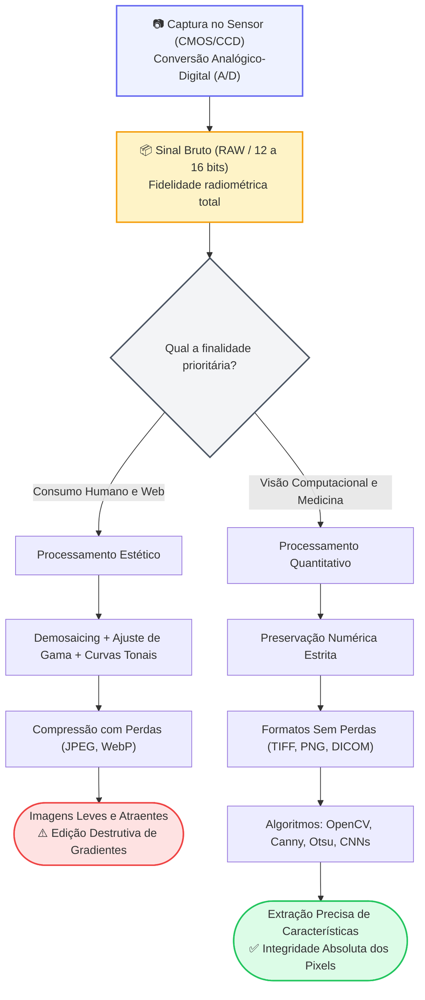

# Atividade sobre Visão Computacional: O Dilema dos Formatos e Edição de Imagens

## 👨‍🏫 Informações Acadêmicas
- **Instituição:** Faculdade de Tecnologia de Ferraz de Vasconcelos (FATEC-FV)
- **Curso:** Análise e Desenvolvimento de Sistemas (ADS)
- **Disciplina:** Visão Computacional / Trabalho de Graduação (TG)
- **Professora Orientadora:** Profa. Márcia Bissaco
- **Pesquisador / Discente:** Josias Sobrinho
- **Semestre:** 2026/2

---

## 1. Introdução: O Dilema Central da Manipulação de Imagens

No processamento digital de imagens e na visão computacional, a escolha do formato do arquivo e o método de manipulação definem o sucesso ou o fracasso de um sistema. Existe uma contradição inerente entre duas finalidades distintas:

1. **Consumo Humano (Agradabilidade Visual):** O olho humano possui percepção não-linear de brilho e é muito mais sensível a variações de luminância do que de crominância (cores). Para nós, uma imagem tratada com curvas de tom, realces de saturação e compressão agressiva parece nítida e agradável.
2. **Visão Computacional e Diagnóstico Médico (Fidelidade Numérica):** Os algoritmos de inteligência artificial e processamento digital (como detectores de bordas de Sobel/Canny, limiarização de Otsu e redes neurais convolucionais) não "veem" estética; eles operam sobre matrizes numéricas f(x, y) de intensidades de luz e gradientes físicos.

> [!IMPORTANT]
> **O Dilema da Edição Destrutiva:** A edição visual comum busca adequar a imagem aos limites biológicos dos nossos olhos. Contudo, filtros estéticos, ajustes arbitrários de contraste e compressões com perdas alteram as distribuições originais dos histogramas. Essa alteração é destrutiva, pois elimina dados sutis que algoritmos de medição, segmentação ou detecção médica necessitam para operar com confiabilidade.

---

## 2. Paradigmas de Armazenamento e Compressão

O universo das imagens digitais se divide fundamentalmente em três abordagens de representação e armazenamento:

### 2.1 Imagens Brutas e Sem Compressão (RAW, BMP)
* **Conceito:** O formato **RAW** (do inglês, "cru" ou "bruto") contém os dados numéricos gravados diretamente a partir dos fotodiodos do sensor (CMOS/CCD), antes de qualquer interpolação de cor (*demosaicing* da matriz de Bayer) ou compensação de curva gama. Outro formato histórico sem compressão é o **BMP** (Bitmap).
* **Vantagens:** 
  - Máxima fidelidade física e radiométrica (frequentemente com 12, 14 ou 16 bits por canal, superando os 8 bits convencionais).
  - Preservação total de informações sem artefatos matemáticos.
* **Desvantagens:** 
  - Arquivos gigantescos que consomem elevada memória RAM e espaço em disco.
  - Aparência inicial inadequada para visualização direta sem processamento (um arquivo RAW puro aparenta ser escuro, acinzentado e de baixo contraste, pois carece da curva gama de visualização humana).

### 2.2 Imagens Comprimidas Sem Perdas (*Lossless*: PNG, TIFF, DICOM)
* **Conceito:** Reduzem o tamanho do arquivo explorando a redundância estatística dos dados (como repetições espaciais contínuas), sem descartar nenhum valor numérico. Após a descompressão, a imagem restaurada é idêntica, bit a bit, à original.
* **Aplicações:** Gráficos técnicos, máscaras de segmentação e imagens médicas (**DICOM**). No diagnóstico médico por imagem (como tomografias e ressonâncias), utilizam-se bits de paridade e códigos de integridade para eliminar o risco de perdas ou corrupção de dados.

### 2.3 Imagens Comprimidas Com Perdas (*Lossy*: JPEG, WebP)
* **Conceito:** Reduzem drasticamente o tamanho do arquivo descartando componentes de alta frequência espacial e sutilezas de cor imperceptíveis à visão humana (baseando-se no modelo psicovisual).
* **Vantagens:** Alta taxa de compressão (geralmente 10:1 ou superior), economizando armazenamento e acelerando transferências de rede.
* **Desvantagens:** A perda de informação é irreversível. O processo gera artefatos de quantização (como descontinuidades em blocos de 8x8 pixels e anéis de ruído em bordas), os quais introduzem ruídos e bordas espúrias em algoritmos de Visão Computacional.

---

## 3. Análise Comparativa dos Principais Formatos Digitais

Conforme solicitado na proposta do trabalho, analisamos os três formatos mais amplamente utilizados no processamento de imagens e suas diferenças cruciais:

| Formato | Tipo de Compressão | Profundidade de Bits Típica | Suporte a Transparência | Uso Primário | Impacto em Visão Computacional |
| :--- | :--- | :--- | :--- | :--- | :--- |
| **JPEG** | Com perdas (*Lossy* via DCT) | 8 bits / canal (24 bits RGB) | ❌ Não | Fotografias comuns e web | **Negativo:** Artefatos de bloco (8x8) degradam a precisão de bordas (Canny/Sobel) e distorcem valores de pixel. |
| **PNG** | Sem perdas (*Lossless* via DEFLATE) | 8 ou 16 bits / canal | ✔️ Sim (Canal Alfa de 8 bits) | Gráficos, diagramas e interfaces | **Excelente:** Preserva bordas nítidas e permite sobreposição de máscaras binárias e regiões de interesse (ROI). |
| **TIFF** | Sem perdas (LZW/ZIP) ou sem compressão | Até 32 bits por canal (inteiro ou float) | ✔️ Sim (Múltiplos canais) | Imagens médicas, satélites e microscopia | **Ideal:** Padrão ouro científico para medidas fotométricas, sensoriamento multiespectral e processamento com OpenCV. |

### 🔍 Diferenças Técnicas e Impacto Prático:
* **JPEG vs. PNG:** O JPEG divide a imagem em blocos de 8x8 pixels e aplica a Transformada Discreta de Cosseno (DCT), descartando detalhes finos para priorizar espaço. Se aplicado a um desenho técnico ou a um código de barras, gera borrões nas bordas. Já o PNG emprega pré-filtros preditivos associados ao algoritmo DEFLATE (LZ77 + Huffman); ele não altera nenhum pixel, sendo a escolha ideal para armazenar resultados de segmentação ou grafos de anotação.
* **O Papel do TIFF:** Ao contrário dos formatos de consumo rápido na web, o TIFF aceita múltiplos canais de dados (além do RGB convencional) e profundidades de cor elevadas (16 ou 32 bits em ponto flutuante), essenciais para representar faixas dinâmicas completas sem saturação (clipping).

---

> [!NOTE]
> **Estudo de Caso Prático Complementar:** Para uma demonstração prática em laboratório com código Python/OpenCV deste dilema (comparação de OCR em placa de veículo sob sombra entre WebP Lossy vs. BMP não comprimido), consulte o documento [experimento-pratico.md](experimento-pratico.md).

## 4. Representação Visual: Mapa Mental e Árvore de Decisão

O diagrama abaixo sintetiza o ciclo da imagem, desde a captação pelo sensor ótico até a tomada de decisão sobre o formato adequado:

---

## 5. Recurso Audiovisual e Comentário Autoral

* **Vídeo Indicado:** *"How JPEG Works (and why it loses detail)"* — Canal Computerphile (Apresentado pelo Dr. Mike Pound, Universidade de Nottingham)
* **Link de Acesso:** [https://www.youtube.com/watch?v=Q2aEzeMDHMA](https://www.youtube.com/watch?v=Q2aEzeMDHMA)
* *(Alternativa didática nacional: "Formatos de Imagem: JPG, PNG, GIF, SVG e WEBP" — [https://www.youtube.com/watch?v=Bsd5iRzJ5b8](https://www.youtube.com/watch?v=Bsd5iRzJ5b8))*

> [!TIP]
> ### 💡 Síntese Autoral do Aprendizado
> *"Compreendi que a compressão com perdas (como a do JPEG) foi engenhosamente concebida para explorar os limites biológicos da visão humana — que é pouco sensível a detalhes finos de cor e a variações abruptas de alta frequência espacial. Contudo, em Visão Computacional, o computador não 'aprecia' a imagem: ele processa matrizes numéricas puras. Dessa forma, qualquer simplificação voltada ao conforto do olho humano torna-se ruído destrutivo para os filtros de convolução e segmentação, tornando indispensável o emprego de formatos íntegros e sem perdas (como PNG, TIFF e DICOM) em diagnósticos médicos e análises científicas."*

---

## 6. Referências Bibliográficas

1. **GONZALEZ, Rafael C.; WOODS, Richard E.** *Processamento Digital de Imagens*. 3. ed. São Paulo: Pearson Prentice Hall, 2010.
2. **BARELLI, Felipe.** *Introdução à Visão Computacional: Uma abordagem prática com Python e OpenCV*. São Paulo: Casa do Código, 2018. ISBN: 9788594188588.
3. **NEMA (National Electrical Manufacturers Association).** *Digital Imaging and Communications in Medicine (DICOM)*: Standard PS3.1-2023. Disponível em: <https://www.dicomstandard.org/>.
4. **W3C (World Wide Web Consortium).** *Portable Network Graphics (PNG) Specification (Second Edition)*. ISO/IEC 15948:2004. Disponível em: <https://www.w3.org/TR/PNG/>.
